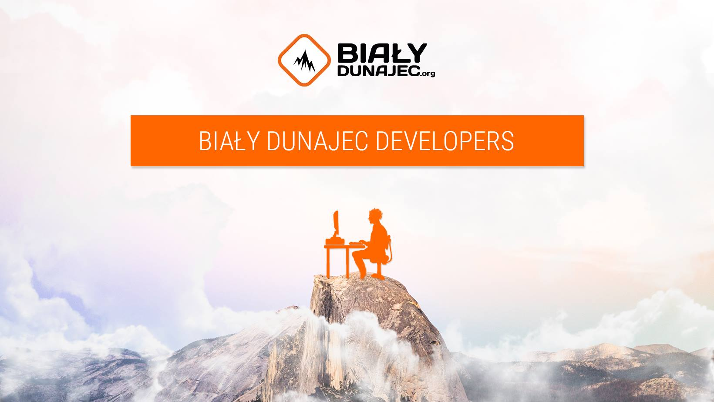

# 🌟 Monorepo 
# ⛺ Obóz Adaptacyjny Duszpasterstw Akademickich Wrocławia i Opola w Białym Dunajcu

<p align="center">
  
</p>

## Run everything locally

Only Docker is needed (JDK 8 and Node are used inside the build images):

```bash
docker compose up --build -d   # first build takes a few minutes
docker compose down -v         # stop and drop the databases
```

- Main page: http://localhost:4200
- Admin panel: http://localhost:4201 (login `admin` / `test1234`, sample data is loaded on first start)
- Backend / Swagger: http://localhost:6655/swagger-ui/index.html
- PostgreSQL: `localhost:6645`, MongoDB: `localhost:6646`

Camp news come from `bialydunajec-news/infrastructure/src/main/resources/mock-camp-news` (a few posts copied from the
Facebook page), because local profiles have no Facebook token (`bialydunajec.camp-news-provider: mock`).

## Backend


## Main (Camper) Frontend 


## Admin Frontend